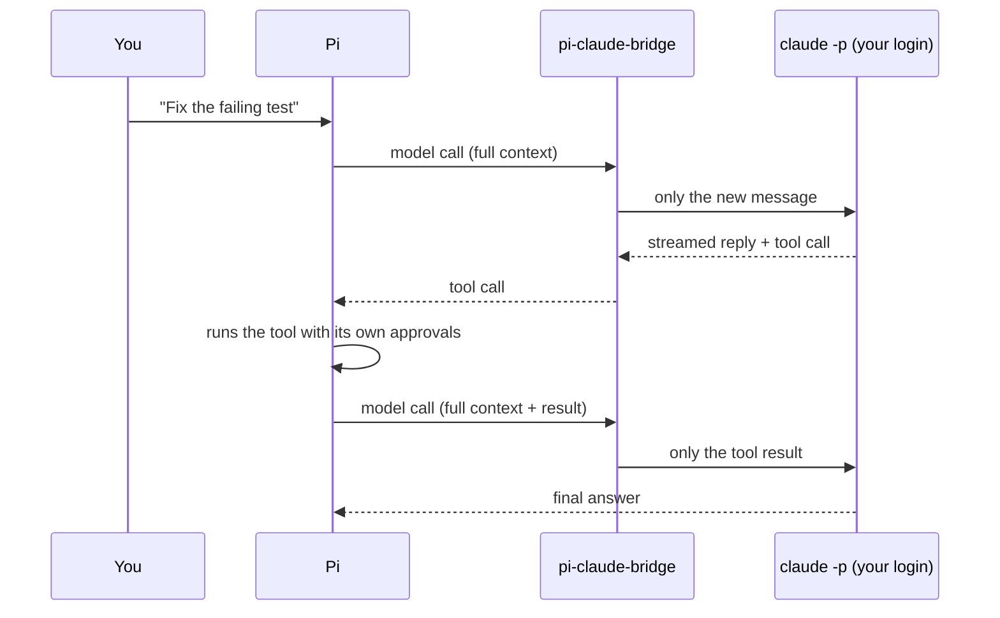

<div align="center">

# pi-claude-bridge

**Use your Claude Pro or Max subscription as a model in [Pi](https://github.com/earendil-works/pi).**

One long-lived Claude Code session per Pi session. Only new input goes over the wire.

[](https://github.com/Master0fFate/pi-claude-bridge/actions/workflows/ci.yml)
[](LICENSE)
[](https://github.com/earendil-works/pi)
[](https://claude.com/claude-code)


[Quick start](#quick-start) · [Tutorials](#tutorials) · [Models](#models) · [Configuration](#configuration) · [Troubleshooting](#troubleshooting)

</div>

---

## Why

Most bridges replay the whole conversation on every turn. On a long session that eats your plan limits, and the prompt cache rarely survives.

This bridge keeps one `claude` process alive for each Pi session and talks to it in Claude Code's own headless mode. After the first message, every Pi model call sends only what is new:

- your next message, or
- the results of the tool calls Claude asked for.

Claude keeps the conversation and its prompt cache stays warm. When Pi restarts, the bridge resumes the same Claude session instead of starting over.

A real run on Haiku, from `npm run verify`:

| Step | Uncached input | Read from cache |
|---|---:|---:|
| First message | 2 | 1,339 |
| Tool call | 4 | 2,703 |
| Tool result | 2 | 3,084 |
| Follow-up | 4 | 3,182 |
| After restarting Pi | 4 | 3,212 |

## How it works



- **Pi owns the tools.** They reach Claude through an in-process MCP server, so Pi's approvals, permissions, and output rules still apply.
- **Claude Code's own extras are off.** No built-in tools, no `CLAUDE.md` or settings files, no hooks, no `@file` or slash-command expansion of your messages.
- **Honest billing.** The bridge runs the official CLI in its documented scripted mode with your own login. It does not disguise itself as anything else.

## Quick start

You need [Pi](https://github.com/earendil-works/pi). If you do not have it yet:

```sh
# macOS, Linux
curl -fsSL https://pi.dev/install.sh | sh

# any platform, with Node 22.19 or later
npm install -g --ignore-scripts @earendil-works/pi-coding-agent
```

### 1. Install Claude Code and sign in

```sh
# macOS, Linux, WSL
curl -fsSL https://claude.ai/install.sh | bash
```

```powershell
# Windows
irm https://claude.ai/install.ps1 | iex
```

Run `claude` once and sign in with `/login`, using the account that has your Pro or Max plan.

### 2. Install the bridge

```sh
pi install git:github.com/Master0fFate/pi-claude-bridge
```

<details>
<summary>Prefer a download? Install from a release instead.</summary>

1. Download `pi-claude-bridge-vX.Y.Z.zip` from the [latest release](https://github.com/Master0fFate/pi-claude-bridge/releases/latest).
2. Unzip it to a folder you will keep, for example `~/pi-packages/pi-claude-bridge`.
3. Point Pi at that folder:

   ```sh
   pi install ~/pi-packages/pi-claude-bridge
   ```

To update, replace the folder's contents with a newer release. To check a download, compare it with `SHA256SUMS.txt` from the same release.
</details>

### 3. Pick a model

Inside Pi, open the model picker with `/model` and choose a `claude-bridge/...` model. Or start Pi with one:

```sh
pi --model claude-bridge/claude-sonnet-5-5
```

Done. Your next message goes through your subscription.

### Update or remove

```sh
pi update git:github.com/Master0fFate/pi-claude-bridge
pi remove git:github.com/Master0fFate/pi-claude-bridge
```

To pin a release instead of following `main`, install with a tag: `pi install git:github.com/Master0fFate/pi-claude-bridge@v0.1.0`. The bridge keeps its state in `~/.pi/agent/claude-bridge`; delete that folder after removing it if you want a clean slate.

## Tutorials

### Set the effort

Pi's thinking level becomes Claude Code's effort level. Change it at any time; the running Claude session picks it up without a restart.

```sh
pi --model claude-bridge/claude-opus-5-5:xhigh
```

| Pi level | Claude effort |
|---|---|
| `minimal` (Fable only) | `low` |
| `low` | `low` |
| `medium` | `medium` |
| `high` | `high` |
| `xhigh` | `xhigh` |
| `max` | `max` |

These models always think, so Pi does not offer `off`.

### Run a one-off prompt from a script

```sh
git diff | pi --print --model claude-bridge/claude-haiku-5-5 "Review this change"
```

### Watch what the bridge sends

Set `PI_CLAUDE_BRIDGE_DEBUG=1` to log one line per model call to stderr:

```text
[claude-bridge] fresh 0193…: sending 1 message(s)
[claude-bridge] reuse 0193…: sending 1 new message(s)
[claude-bridge] resume 0193…: sending 1 new message(s)
```

| Decision | Meaning |
|---|---|
| `fresh` | First call of a session. The conversation so far is sent once. |
| `reuse` | The live Claude session continues. Only new input is sent. |
| `resume` | Pi restarted, or the Claude process was closed. The saved Claude session is resumed. Only new input is sent. |
| `reset` | Pi rewrote history (see [When the conversation is sent again](#when-the-conversation-is-sent-again)). |

### Prove it on your machine

```sh
git clone https://github.com/Master0fFate/pi-claude-bridge
cd pi-claude-bridge
npm install
npm run verify
```

`verify` runs a real Pi session on Haiku through your subscription: a plain reply, a tool call, a follow-up, and a restart in a new process. It fails if any call after the first sends more than 2,000 uncached input tokens, or if the restart does not resume the same Claude session. It costs a few thousand Haiku tokens and cleans up after itself.

## Models

| Model | ID |
|---|---|
| Claude Opus 5.5 | `claude-bridge/claude-opus-5-5` |
| Claude Sonnet 5.5 | `claude-bridge/claude-sonnet-5-5` |
| Claude Haiku 5.5 | `claude-bridge/claude-haiku-5-5` |
| Claude Fable 5.1 | `claude-bridge/claude-fable-5-1` |

Which models you can use depends on your plan. Pi shows the cost as zero, because usage counts against your plan, not a per-token bill. Token counts are still reported.

## Configuration

All settings are optional environment variables.

| Variable | Default | Purpose |
|---|---|---|
| `PI_CLAUDE_BRIDGE_EXECUTABLE` | found on `PATH` | Path to the `claude` executable |
| `PI_CLAUDE_BRIDGE_IDLE_MS` | `1800000` (30 min) | Close a Claude process after this long without a model call. A process that waits for tool results stays open. |
| `PI_CLAUDE_BRIDGE_MAX_SESSIONS` | `4` | Live Claude processes kept at once |
| `PI_CLAUDE_BRIDGE_HOME` | `~/.pi/agent/claude-bridge` | State folder: one small checkpoint file per Pi session, kept for 7 days |
| `PI_CLAUDE_BRIDGE_DEBUG` | off | Log each call's decision to stderr |

When `claude` is not on `PATH`, the bridge also looks in `~/.local/bin`, `~/.claude/local`, `/opt/homebrew/bin`, `/usr/local/bin`, and on Windows `%APPDATA%\npm`. That covers desktop apps on macOS, which do not get your shell's `PATH`.

The Claude process always uses your subscription login. The bridge removes `ANTHROPIC_API_KEY`, `ANTHROPIC_AUTH_TOKEN`, `ANTHROPIC_BASE_URL`, `CLAUDE_CODE_ENTRYPOINT`, and the Bedrock, Vertex, and Foundry switches from its environment, and turns off Claude Code's telemetry, error reporting, auto-updater, and other non-essential traffic.

## When the conversation is sent again

The bridge sends past messages only when the Claude session cannot continue on its own:

- **The first call of a Pi session.** The conversation so far goes over once.
- **Pi rewrote history.** Compaction, branching, editing an earlier message, or switching to another provider and back. The new history goes over once. After compaction that is only the summary and the recent messages.
- **Pi stopped in the middle of a tool call.** After a restart, the bridge resumes the Claude session and sends only the unfinished tail.
- **Claude's own session file is gone.** For example, after Claude Code cleaned up old sessions.

Errors, retries, and aborts do not cause a resend. A failed turn keeps the same Claude process, and Pi's automatic retry sends a one-word nudge.

## Troubleshooting

<details>
<summary><b>"Claude Code is not installed or not on PATH"</b></summary>

Install Claude Code (step 1), or set `PI_CLAUDE_BRIDGE_EXECUTABLE` to the full path of `claude`.
</details>

<details>
<summary><b>Replies fail with a login or authentication error</b></summary>

Run `claude` in a terminal and sign in again with `/login`.
</details>

<details>
<summary><b>"Third-party apps now draw from your extra usage"</b></summary>

That error comes from tools built on the Claude Agent SDK. This bridge does not use the SDK. If you see it here, update Claude Code with `claude update` and open an issue with the output of `claude --version`.
</details>

<details>
<summary><b>Usage seems higher than expected</b></summary>

Run Pi with `PI_CLAUDE_BRIDGE_DEBUG=1` and look for `reset` lines; each one names its reason. If you see them without compaction, branching, or a provider switch, open an issue with the log.
</details>

## Good to know

- Tools appear to Claude as `mcp__pi__<name>`. The bridge adds one line to the system prompt to say so.
- If you type a message while tools are still running, it reaches Claude together with the last tool result.
- Claude Code can still compact its own session when it grows large, independently of Pi.
- One-off calls from Pi, such as compaction summaries, run in a short-lived Claude process that keeps no session file.
- Claude Code stores its session files in its own projects folder, under the bridge's work directory.

## Requirements

- [Pi](https://github.com/earendil-works/pi) 1.1 or later (tested on 1.2.0)
- [Claude Code](https://claude.com/claude-code) 2.1 or later (tested on 2.1.296), signed in with a Pro or Max plan
- Windows, macOS, or Linux

## License

[MIT](LICENSE)
